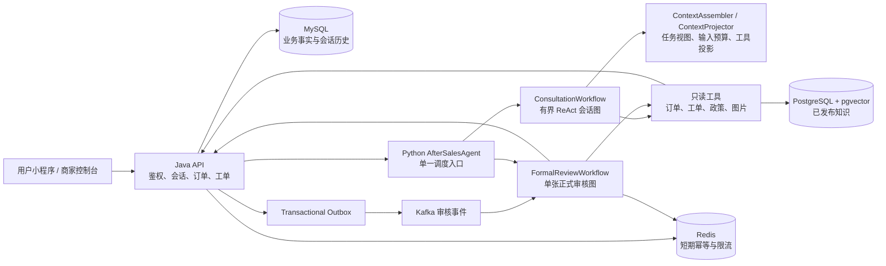
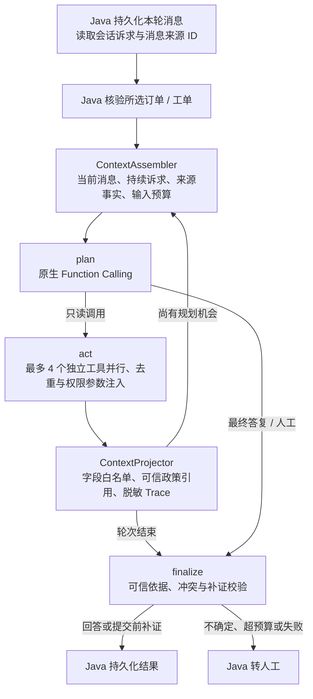
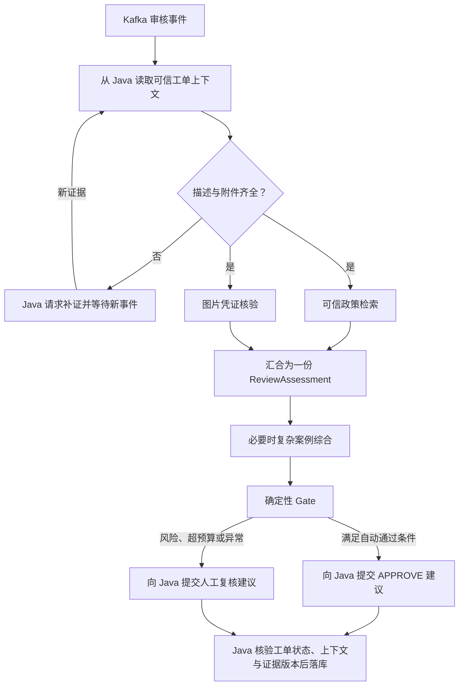

# Ecommerce 智能售后系统

面向电商售后咨询与工单审核的全链路项目。Java 管理订单、会话、工单、权限与状态流转；Python `AfterSalesAgent` 负责会话工具规划、知识检索和正式审核建议。AI 通过 Java 内部接口读取业务事实或提交建议，最终业务结果由 Java 校验并落库。

## 当前架构



`AfterSalesAgent` 只有一个调度入口。HTTP 咨询进入会话 ReAct 图；Kafka 售后审核事件进入正式审核图。这是两个业务场景，正式审核本身只有**一张图、一份可信工单上下文、一份审核评估**。项目已移除旧 Skill 注册与双审核工作流代码，不需要 MCP 才能运行。

| 组件 | 职责 |
| --- | --- |
| Java / MySQL | 用户与商家权限、订单、工单、会话消息、审核结果、事务与状态机；MySQL 是业务事实来源。 |
| Python Agent | LangGraph 编排、只读工具规划、Agentic RAG、图片核验、事实冲突识别与建议生成。 |
| PostgreSQL / pgvector | 已发布知识、Chunk、Embedding 与检索元数据；不保存业务工单状态。 |
| Redis | 短期幂等、缓存与限流；不承担长期记忆。 |
| Kafka / Outbox | 异步投递正式审核事件；重复投递由幂等与版本校验处理。 |

## 会话 Agent



- 最多两轮规划、八次模型工具调用；独立只读查询并行，重复查询跳过。模型看不到写工具。订单与工单归属先经 Java 核验，商家、品类、政策版本和业务时间过滤条件来自核验结果。
- 工具观测按白名单投影；政策仅展示经过严格过滤的来源、版本、Chunk ID 与必要原文。用户陈述、政策文本和图片 OCR 均作为数据，不获得指令权限。
- 案件事实标注来源、观测时间、可信等级、工单版本和证据版本。状态矛盾最多重查一次 Java；同版本冲突、无法解释的变化或重查后模型回答已过期时转人工。
- Java/MySQL 保存可重建的会话诉求索引。新消息补充凭证时保留原诉求；当前订单、工单和政策仍重新核验，不把聊天摘要当作业务事实。
- `ContextAssembler` 按当前任务选择事实并控制模型输入预算。第二轮保留关键事实与新增观测；必要依据超限时转人工，不裁掉政策条件后继续自动判断。对外 `tool_trace` 不包含工具原始数据。

## 正式审核



补证仅发生在正式评估之前。新凭证到达后重读 Java 工单并重新做政策与视觉评估；进入并行评估后，Gate 只选择自动通过建议或人工复核建议。模型响应超时、无效 JSON、检索降级或必要依据超出输入预算时走安全降级；不会把旧评估当作新证据的结论。

## 知识检索与可靠性

知识文档由 Java 管理草稿、发布和版本。标准检索链路是 `text-embedding-v3 → pgvector / pg_trgm → RRF → Reranker`；当知识覆盖不足时，Agentic RAG 最多生成三条互补查询并受限重检索。可信政策资格、商家与品类过滤、版本匹配由代码校验，模型不能自行宣布检索结果可信。[RAG 离线报告](docs/rag-optimization-report.md)与[评测基线](docs/agent-safety-baseline.md)记录了各自的数据集和口径。

正式审核使用 Outbox、Kafka、Redis 幂等认领、有限重试、DLQ 与 Java 版本校验处理重复投递和局部故障。Java 与 Python 通过 Trace ID 串联，Prometheus / Grafana 监控延迟、错误、检索降级、人工接管和异步消费状态。

## 启动与迁移

需要 Docker Desktop，以及未提交的本地配置 `python_agent/.env`。可从 [Python 配置示例](python_agent/.env.example)复制所需变量；真实密钥和密码只放在环境变量或被 Git 忽略的本地配置中。

```powershell
docker compose up -d --build
docker compose ps
```

代码更新后推荐用一条命令重建并验收：构建镜像、拉起链路，并核验服务状态、健康检查、上下文模式、镜像内是否含新代码以及两张迁移表。

```powershell
python tools\verify_docker_stack.py
```

构建阶段默认走国内依赖源（pip 用 `mirrors.aliyun.com`，Maven 用 `maven.aliyun.com`）：`files.pythonhosted.org` 与 Maven Central 直连时大文件会被截断，pip 表现为 jieba 等包的 sha256 校验失败。官方源可按需覆盖：

```powershell
python tools\verify_docker_stack.py --pip-index-url https://pypi.org/simple --maven-mirror-url ""
```

`python tools\verify_docker_stack.py --smoke` 会额外在容器内跑一次真实会话；`--review-consumer-replicas 4` 按压测口径起四个消费副本。

Java 侧分两层检查：`Compose 内网` 从 agent 容器直接请求 `java:8080`，是服务健康与否的权威判据；`宿主机 8080` 额外验证端口映射，且显式绕过系统代理——Windows 上的 Python 会读取注册表里的系统代理（Clash 等），而 `ProxyOverride` 默认的 `<local>` 不覆盖 `127.0.0.1`，会把本机请求也交给代理，表现为 `RemoteDisconnected`。Java 没有 healthcheck，容器进入 running 后仍需数十秒才能就绪，因此这两项都会重试等待。

已有数据卷不会重新执行初始化 SQL。升级旧库时，执行 MySQL 与 PostgreSQL 正式迁移：

```powershell
Get-Content sql/migrations/20261028_add_chat_context_projection.sql -Raw | docker compose exec -T mysql sh -c 'mysql -u ecommerce -p"$MYSQL_PASSWORD" ecommerce_aftersales'
Get-Content sql/migrations/20261028_add_agent_trace_store.sql -Raw | docker compose exec -T postgres psql -U postgres -d after_sales_rag -v ON_ERROR_STOP=1
```

用 `docker compose exec -T mysql sh -c 'mysql -u ecommerce -p"$MYSQL_PASSWORD" ecommerce_aftersales -e "SHOW CREATE TABLE chat_context_projection"'` 核验表结构。该表仅保存诉求与来源消息 ID 的派生索引；消息历史仍在 `chat_message`，索引缺失时可重建。

| 服务 | 地址或核验命令 |
| --- | --- |
| Java API | `http://127.0.0.1:8080/api` |
| Java 健康检查 | `http://127.0.0.1:8080/api/actuator/health` |
| Python Agent 健康检查 | `docker compose exec -T agent python -c "import urllib.request; print(urllib.request.urlopen('http://127.0.0.1:8000/api/health', timeout=10).read().decode())"` |
| 用户端 | `frontend/uniapp`，按目录内脚本启动 |
| 商家端 | `frontend/staff-auth-test-ui`，按目录内脚本启动 |

不要用 `docker compose down -v` 清理本地环境，否则会删除数据库数据卷。

## 上下文模式与评测现状

`AGENT_CONTEXT_MODE=active` 是代码和 Compose 默认值；`shadow` 仅构建新视图，仍用旧提示词回答；`legacy` 使用旧规划输入。需要回退时修改运行环境并重启 Agent。模型上下文上限由 `AGENT_CONTEXT_WINDOW_TOKENS` 设置，另预留输出预算与 `AGENT_CONTEXT_SAFETY_TOKENS`。更换模型时应按实际窗口调整配置。

当前[100 条合成会话离线报告](python_agent/evaluation/context_projection_contract_report.json)只验证提示词契约和估算长度：旧版两轮输入中位数 4817 Token，新版 5016 Token，**没有显示 Token 节省**，也未测答案质量。一次双模式真实模型烟测仅用于验证链路，不能代表整体效果。`active` 是本次明确要求的启用状态；性能与质量收益仍须按[上下文工程 PRD](docs/prd-agent-context-engineering.md)做完整成对评测后才能宣称。[交付与限制说明](docs/context-engineering-implementation.md)列出已执行验证。

## 测试与目录

```powershell
.\mvnw.cmd test
python_agent\.venv\Scripts\python.exe -m pytest python_agent/tests -q
```

```text
src/                    Java 业务服务与测试
python_agent/           Agent、RAG、工具、评测与测试
frontend/               uni-app 用户端、Vue 商家端
sql/                    MySQL / PostgreSQL 初始化与正式迁移
observability/          Prometheus / Grafana 配置
docs/                   架构、PRD、SOP 与评测报告
compose.yml             本地完整后端链路
```

本机密钥、面试资料、临时压测产物和调试脚本不属于运行交付，不应提交到远程仓库。
