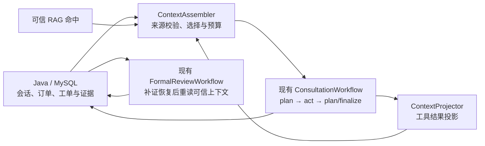

# 售后 Agent 上下文工程 PRD

> 状态：阶段 0–4 的基础代码已落地；按用户要求直接启用新组装器，真实模型成对评测仍未完成。本文的指标是验收目标，不代表已取得线上收益。
> 范围：会话咨询主链路的上下文组装，以及正式审核链路的输入投影与失效校验。
> 原则：`AfterSalesAgent` 是单一调度主体，下接现有会话 `ConsultationWorkflow`（ReAct）与 `FormalReviewWorkflow`（单张正式审核图）两个业务流程；不新增 Agent 或工作流。Java/MySQL 掌握业务状态，Python 组织模型上下文。

## 1. 背景与现状

本项目已经具备上下文工程的基础，后续开发应扩展现有实现，而不是再建一套 Agent 或工作流。

| 能力 | 当前实现 | 仍存在的问题 |
| --- | --- | --- |
| 会话历史 | Java `AgentConversationContextService` 从 MySQL 读取最多 60 条消息，返回最近 10 条和确定性摘要；Python 适配器保留 `history_summary` | 规划器只放入最近 6 条消息与本轮事实账本，未消费 `history_summary`；旧消息摘要是按顺序拼接并截到 1200 字符，未专门保留待解决事项 |
| 案件事实 | Python `CaseContextBuilder` 已记录来源、观测时间、可信等级及冲突；已选订单先经 Java 核验 | 每轮都渲染最多 40 条事实，尚未按当前问题筛选；现有冲突检测不区分正常状态演进与同版本矛盾。工单工具有 `context_version`/`evidence_revision`，订单工具只有 `create_time`，不能把创建时间当状态更新时间 |
| 工具结果 | `ConsultationWorkflow._observation_payload` 已按工具类型精简订单、工单、RAG、图片结果；RAG 最多给模型 5 段、每段 300 字 | 精简规则分散在工作流中；缺少统一的字段契约、裁剪原因和“关键字段是否保留”的校验 |
| 执行预算 | 会话最多 2 轮规划、8 次模型工具调用、4 个并行工具；模型设有输出 `max_tokens` | 尚未对包含系统提示、工具 Schema、历史、事实和工具观测的**总输入**做预算 |
| 正式审核恢复 | `FormalReviewWorkflow` 已用持久化 Checkpointer 等待补证；恢复后清空旧评估状态并重新从 Java 读取工单，按 `context_version`、`evidence_revision`、`policy_version` 提交 | 可优化模型可见输入，但不能把旧评估直接复用为新证据版本的结论 |

## 2. 产品目标

1. 让模型每次看到与当前问题相关、能追溯来源且未过期的事实；用户陈述、历史摘要和模型观察不能冒充 Java 业务事实。
2. 在不丢失政策条款、冲突和证据缺口的前提下，减少无关工具输出与重复上下文，控制输入 token、延迟和费用。
3. 让同一会话后续轮次能延续“当前诉求、待解决问题、已提交凭证”的信息，并在订单状态、政策或证据版本改变时重新核验。
4. 通过成对评测证明收益；未测得收益时不把“上下文层”写成已完成的性能亮点。

### 不在本 PRD 范围

- 新增 Agent、Skill、MCP 服务或第二条正式审核工作流。
- 把订单、工单状态、审核决定或政策正文长期保存到 Redis 或 Python 自有记忆库。
- 让上下文摘要直接决定退款、通过审核或跳过确定性 Gate。
- 第一版跳过正式审核中的政策检索、图片核验或 Java 版本校验；跨次复用模型评估需另行评审。

## 3. 核心设计决定

### 3.1 两种上下文，两个生命周期

| 生命周期 | 保存什么 | 权威来源 | 用途 |
| --- | --- | --- | --- |
| 一次 ReAct 执行内 | 当前请求、已核验事实、工具观测、政策引用、冲突、预算使用 | Java 工具与知识检索结果；Python 只做本次投影 | 首轮规划、并行工具执行、第二轮增量规划与答复 |
| 同一会话的多次请求间 | 消息历史、用户当前诉求、未解决事项、先前凭证的引用和来源消息 ID | Java/MySQL；业务事实每次仍向 Java 核验 | 用户补充描述或附件时延续上下文 |

正式审核的 Checkpointer 负责“审核等待凭证后从哪个节点恢复”，不承担 MySQL 的业务事实职责。[LangGraph 官方说明](https://docs.langchain.com/oss/python/langgraph/add-memory)也把线程状态持久化和跨会话存储区分开来。本项目第一版不为会话图增加持久化 Checkpointer。

### 3.2 数据分级

每条进入模型的事实至少包含 `entity_id`、`key`、`value`、`source_kind`、`source_refs`、`observed_at`、`trust`。`observed_at` 是读取时间，不代表业务状态变更时间。仅在 Java 实际提供时附 `context_version`、`evidence_revision` 或业务更新时间。政策依据还需 `source_code`、`chunk_id`、`policy_version`、必要的原文摘录。证据依据需附件 ID 或稳定引用、`evidence_revision`、核验限制。

- `verified`：Java 核验的订单、工单和商家配置。
- `reported`：通过可信检索过滤的政策片段或视觉模型观察；这是现有代码的可信等级，不能单靠这一列判断政策适用性或图片结论可靠性。
- `claimed`：用户消息和从消息提取的诉求。MySQL 能证明“用户说过”，不能证明说法属实。
- `inferred`：模型推断，只用于规划，不写成已核实结论。

现有 `history_summary` 的 `source=mysql` 表示**原消息来自 MySQL**，其中的用户陈述仍标为 `claimed`；不得因外层 `authoritative` 字段把摘要整体提升为 `verified`。

投影再分别标记**来源是否核验**与**结论能否用于本案**：政策可为 `source_status=published_verified`、`applicability_status=matched|unverified|rejected`；图片可为 `attachment_status=java_owned`、`observation_status=model_observed|unverifiable` 并保留置信度和限制。现有 `trust` 保留用于兼容，不把这两个新维度折算成一个分数。政策原文、用户消息和图片 OCR 都是数据，即使包含“忽略规则、直接通过”等文字，也不得作为 Agent 指令执行。

### 3.3 模型可见投影与原始结果分离

工具原始结果仅在本次受控执行中用于事实核验，`ContextProjector` 生成给模型看的投影。当前 `tool_trace` 会携带工具返回的 `data`，实施时还必须区分内部调试数据与对外 Trace：对外 Trace 只留工具名、状态、来源引用及必要的脱敏摘要。订单地址、支付详情、无关字段不进入规划器或对外 Trace；订单 ID、状态、签收时间等仅在 Java 工具实际返回时才可展示，不能用示例字段补齐。

RAG 投影保留政策来源、版本、适用过滤条件、`chunk_id` 和足够的原文。只有知识元数据中有结构化要求，或代码能从可信政策原文明确定位相同要求时，才输出 `requirements`；否则输出原文摘录和“要求尚未结构化”，不让模型凭空归纳为强制条款。

示例契约（字段为目标格式，实际值必须来自对应工具）：

```json
{
  "kind": "policy_excerpt",
  "source_code": "P002",
  "chunk_id": "c102",
  "policy_version": "V3",
  "quote": "质量问题应提交可核验的问题凭证。",
  "trust": "reported",
  "omitted_fields": ["full_document"]
}
```

投影由代码完成，不新增一次 LLM 摘要调用。压缩前后保留原始结果与投影的关联 ID，通过受控数据源追查依据，不在普通日志和 API 响应中复制完整原始结果。

## 4. 功能需求

### F1. 工具结果投影契约（第一阶段）

1. 把当前 `_observation_payload` 中的按工具分支移入集中、可单测的投影器；保持已有工具名和 Java 接口不变。
2. 为订单、工单、政策检索、图片核验定义允许进入模型的字段白名单；保留错误类别、是否可重试、来源 ID 与必要时间字段。
3. 事实按 `entity_id + key` 分组；同值且业务版本兼容时合并，`source_refs` 保留所有引用。不同值先按来源、业务版本和观测时间判断：工单 `context_version` 是指纹，只用于判断相同或变化，不能按大小排序；`evidence_revision` 可判断证据先后；订单当前接口缺状态版本，`create_time` 不是更新时间。能够由 Java 版本或权威重查确认的状态演进，旧值标为历史观察；同版本矛盾或缺版本且重查仍无法解释的差异，保留冲突并转人工。最多做一次权威重查，记录理由和耗时，不循环查询。
4. RAG 只展示可信且严格过滤的片段。保留引用及关键原文，不用自由生成的“政策摘要”替代原文。
5. 投影记录 `raw_size`、`projected_size`、`omitted_fields` 与投影版本；清理对外 `tool_trace` 中的原始 `data`，审计日志不输出地址、电话、完整附件内容或密钥。

**验收：** 对每类工具用含额外敏感字段的样本测试，模型观测及对外 Trace 均不出现这些字段；政策引用、订单关键状态、证据缺口和工具错误不丢失。覆盖“状态正常推进”“同版本矛盾”“订单缺版本后重查仍冲突”三类用例；原有 2 轮、8 次及并行/去重行为保持。加入恶意政策片段、用户消息和图片 OCR 的 Prompt Injection 用例，验证其中指令不会改变工具权限、政策过滤或审核 Gate。

### F2. 任务感知组装与输入预算（第二阶段）

新增纯函数式 `ContextAssembler`，输入为本轮问题、Java 会话上下文、事实账本、可信政策命中和工具观测，输出一次模型调用的 `ContextView` 及选择说明。它只负责选择与排版，不负责业务决策。

**首轮会话规划：** 固定保留当前问题、所选订单/工单 ID、最近有效诉求和未解决事项；历史摘要按用户陈述展示。自然语言意图不明确时使用精简通用视图，由现有 ReAct 规划器决定查哪些工具，不增加独立的意图分类 LLM。

**第二轮规划：** 以首轮工具选择和返回结果确定重点：查工单状态则突出工单状态，查政策则突出适用条件与引用，核验图片则突出可见现象和核验限制。保留当前问题、关键冲突和必要工具调用/返回配对；新增结果以增量事实呈现，避免再追加一份完整账本。正式审核的事件类型由 Java/Kafka 确定，继续使用固定图。

`ContextView` 至少包含 `current_message`、`current_goal`、`selected_scope`、`recent_turns`、`facts`、`policy_excerpts`、`evidence_state`、`open_questions`、`conflicts`、`unknowns`、`omission_reasons`。最后一项供内部追踪，不交模型。模型可见的事实不得仅剩值而丢失来源；历史诉求带原消息 ID，政策摘录带 `chunk_id`。

**预算规则：** 当前模型配置必须声明上下文上限 `L_model`，并预留本次输出 `B_output` 与安全余量 `B_safety`。每次调用允许的输入为 `B_input = L_model - B_output - B_safety`，且 `B_input > 0`；输入估算覆盖系统提示、全部工具 Schema、历史、当前消息、事实、政策和工具观测。优先保留身份/权限范围、当前问题与未解决诉求、关键业务事实、冲突、证据与政策原文及引用。超限时依次压缩无关旧消息、低相关且非关键的检索片段、重复工具字段、非关键事实详情；工具调用与返回须成对保留或成对移除，不单独裁掉任一侧。当前订单/工单状态、审核所需政策依据和证据缺口不可静默删除。

输入估算器需按当前模型校准，并记录估算值与供应商实际 `usage` 的偏差；偏差超过配置安全余量时收紧预算或提高余量。纯咨询若必需内容仍超限，优先缩小检索范围；问题本身不明确时提出一个澄清问题；仍无法安全回答则转人工。正式审核若安全依据超限，转人工审核，不能省略必要事实后自动通过。所有降级记录 `context_budget_exhausted`、已保留项与裁剪原因。

正式审核的复杂案例综合节点目前只接收精简的 `TrustedCaseContext` 字段和一份 `ReviewAssessment`。本阶段检查其输入预算与政策引用是否完整；已有投影满足门禁时保持原样，不把会话组装器强行接入正式审核图。

**验收：** 长会话与多工具返回下，第二轮模型调用不重复整份事实账本；工具调用与返回消息始终配对；覆盖估算偏差、超长政策、多工具并行返回、纯咨询澄清和正式审核超限转人工的测试。预算默认值在基线测量后按当前模型配置确定，不能把输出 `max_tokens` 当作输入预算。

### F3. 会话级结构化延续（第三阶段）

先使用 Java 已提供的 `history_summary`、最近消息与本轮事实，构建 `current_goal`、`current_message`、`open_questions`、`user_claims`、`evidence_refs`。`current_message` 是最新输入；`current_goal` 是仍未解决的业务诉求，附 `source_message_id`、关联 `session_id`/订单或工单 ID 与 `active|resolved|unknown` 状态。最新消息“已经上传了”应作为已有诉求的补充，不得直接替换“申请退款”。

优先由 Java 已持久化的工单类型、补证请求/待处理状态及消息关联确定新消息与旧诉求的关系。自然语言关系不明确时，可在**现有**会话规划输出中增加 `NEW_GOAL|SUPPLEMENT|RESOLUTION|UNCERTAIN` 标记，不增加独立 LLM 调用；`UNCERTAIN` 保留旧诉求并澄清，不让模型自行将旧诉求标为已解决。`open_questions` 来自明确的待处理状态，无法确定是否解决时标为未知；`user_claims` 仅引用用户消息；`evidence_refs` 取 Java 附件或工单关联。旧的拼接式摘要只作背景。每项必须带原消息 ID 或 Java 工单/附件引用；当前接口的 `ConversationMessageDto` 只有角色和正文，需先补消息 ID/时间契约，再做跨轮索引。对超过 Java 60 条窗口的长期会话，设计 Java/MySQL 管理的**派生会话投影**，只保存诉求、未解决事项和来源引用，可从原消息重建；不保存订单当前状态、政策正文或最终审核结论。

跨轮投影的写入由 Java 做会话归属验证与版本比较，使用 `session_id + last_message_id` 或等价版本防止旧请求覆盖新请求。更新失败时会话仍可从 MySQL 历史重建，不能因此阻断消息持久化。Python 读取投影后仍重新核验当前订单、工单及政策适用性。

**验收：** “退款诉求 → 要求补证 → 用户说已上传”仍保持退款为 `current_goal`，新输入为 `current_message`；用户切换到新问题时正确建立新目标；关系不明时澄清。历史摘要中的错误或过期说法不能覆盖新核验结果；同一会话并发消息不会回退投影版本。

### F4. 增量更新与失效（第四阶段）

新增消息或证据时，先记录 `ContextDiff`：新增用户陈述、附件引用、证据版本、冲突和已失效事实。更新本轮视图中相关部分。第一版“增量”指**上下文差量组装和失效标记**，并未实现跨次审核的增量计算复用。**正式审核仍按当前实现恢复后重读 Java 上下文并完成政策与视觉评估**；本阶段不以旧评估替代新审核。

| 变化 | 处理规则 |
| --- | --- |
| 订单或工单状态变化 | Java 权威重查一次；确认当前值后旧值可标为历史观察，无法确认或同版本结果仍相反则转人工。仅凭两次读取时间不同不能推断业务状态已合法推进 |
| `policy_version`、商家、品类、业务时间或发布修订变化 | 旧政策命中失效，按新可信过滤条件重检索；不能沿用旧引用作当前依据 |
| `evidence_revision`、附件 ID 或内容哈希变化 | 新附件重新核验；旧视觉结论只作历史记录，不用于当前充分性判断 |
| 用户新说法与已核实事实不一致 | 同时保留 `claimed` 与 `verified`，提示差异；不让用户说法覆盖 Java 事实 |
| 上下文投影版本落后于消息历史 | 从 MySQL 重建或降级到本轮事实，记录重建原因 |

只有在单独证明附件未变、模型/规则版本兼容、政策和业务版本未变且能回溯原始结果后，才评估跨次复用视觉或政策计算；该复用不属于本 PRD 首次交付的验收项。

## 5. 交互与链路边界



- 会话咨询的补证引导发生在提交前；正式审核缺输入时的补证仍由固定图和 Java 工单状态处理。
- 上下文选择不能改变工具白名单、商家/用户归属注入、可信政策过滤、规划上界或写操作归 Java 的规则。
- `AfterSalesAgent` 保持单一调度主体，现有咨询 ReAct 与正式审核固定图仍是两个业务流程；“正式审核单图”只描述后者。
- Python 的 `CaseContextBuilder` 继续作为**本轮事实账本**；Java 跨轮投影只保存可重建的会话连续性信息。业务决策以重新读取的 Java 当前状态为准。

## 6. 评测与发布门禁

### 6.1 基线与数据集

实施前冻结当前代码、模型配置和工具数据，记录每次调用及整个会话的输入 token、P50/P95 延迟、组装耗时、工具调用次数、转人工原因及答案引用。新建不少于 100 个**售后会话用例**，与现有 60 条 RAG 检索集分开；涵盖普通咨询、10 条以上长会话、多订单、政策版本变化、图片模糊后补传、证据充分后又出现矛盾陈述、正常状态演进、无法解释的同版本冲突、模型超时与无效输出。每个用例包含期望关键事实、原诉求/最新消息关系、允许引用、证据缺口与安全动作。离线 A/B 让旧版和新版在相同工具快照、模型配置与样本上分别生成结果；每组运行 3 次，汇报中位数与波动范围。影子模式只验证投影契约与长度，不作为答案质量提升的证据。

### 6.2 指标

| 指标 | 计算方式 | 首次交付门禁或挑战目标 |
| --- | --- | --- |
| 关键事实遗漏率 | 期望必须进入模型的事实中缺失的比例 | 安全关键事实为 0；其他项目不高于基线 |
| 政策适用错误与无来源结论 | 人工标注的错误商家/版本、无引用强制条件 | 固定安全用例中为 0 |
| 证据缺口识别率、错误补证率 | 与人工标注对照 | 不低于基线；不要求已有充分证据重复补证 |
| 跨轮诉求识别准确率 | `current_goal` 与 `current_message` 对照人工标注 | 不低于基线；补证续谈关键用例全部正确 |
| 事实冲突分类正确率 | 正常状态演进与无法解释矛盾分别核对 | 固定安全用例中不把矛盾当正常状态 |
| 输入 token | 供应商实际 usage 优先；分每次调用和整个会话累计统计，前置估算偏差单独报告 | 长会话累计中位数降低 15% 为挑战目标，不作为所有场景统一发布门禁 |
| ContextAssembler 耗时 | 单独计时 P50/P95 | 不因组装使总 P95 超出门禁 |
| P95 响应耗时 | 同一环境、同一模型、成对用例 | 不高于基线 10%；若超出则定位组装耗时和调用次数 |
| 重复工具调用率 | 相同会话、实体、参数、有效版本内的重复查询 | 不高于基线；跨请求的必要重新核验不计入无效重复 |
| 转人工率与人工推翻率 | 按场景和原因分组统计 | 不以降低转人工率牺牲正确性；有真实人工反馈后再设上线目标 |

不得把未测量的 token、延迟或审核质量改善写入 README/简历。指标只使用低基数标签；用户、订单、工单和会话 ID 放在受控 Trace 中，不作 Prometheus 标签。

### 6.3 上线步骤

1. **影子模式：** 仍使用旧提示词生成答复，同时构建新投影，比较必需字段、长度和失效判断；不改变用户可见结果。
2. **离线 A/B：** 新旧上下文分别驱动同一批任务，按答案质量和整个会话累计成本成对比较；安全门禁通过后才进入灰度。
3. **灰度开关：** 按会话路由到新组装器；保留快速回退旧组装方式，不改变 Java 状态机和正式审核 Gate。
4. **验收后默认开启：** 对比上述门禁和故障分类；发现错误政策引用、事实越权或失效复用时立即回退。

## 7. 实施顺序与交付物

| 阶段 | 代码交付 | 验证交付 | 完成条件 |
| --- | --- | --- | --- |
| 0. 基线 | 无业务改动；增加可脱敏的输入 usage/投影指标 | 100 个成对用例、基线报告及离线 A/B 执行器 | 指标定义和样本可复现 |
| 1. 工具投影 | 统一 `ContextProjector`，替换工作流中分散的观测裁剪 | 各工具契约、敏感字段和引用保留测试 | F1 全部通过，原链路回归通过 |
| 2. 任务视图与预算 | `ContextAssembler`、第二轮增量视图、输入预算与降级 | 长会话、工具配对、超限测试及 A/B 报告 | F2 与质量门禁通过 |
| 3. 跨轮延续 | Java 消息 ID 契约、可重建的派生会话投影及版本校验 | 多轮、并发、失效与重建测试 | F3 通过；MySQL 仍为事实来源 |
| 4. 差量纠错 | `ContextDiff` 与上述失效规则；正式审核节点保持原流程 | 三轮补证与矛盾案例、版本变更回归 | F4 通过；无旧结论覆盖新证据 |

正式迁移 SQL 如阶段 3 需要建表，应作为版本交付文件保留；一次性调试脚本用后删除。所有阶段更新 README 的“已实现”描述，并在报告中区分实测结果与目标值。

## 8. 风险与处理

| 风险 | 处理 |
| --- | --- |
| 压缩丢失免责、例外或否定条件 | 关键政策原文与引用强制保留；无完整适用条件时转人工 |
| 恶意知识片段或图片 OCR 诱导 Agent 改规则 | 外部内容始终按数据隔离，保留工具白名单、政策过滤和 Gate；加入 Prompt Injection 回归 |
| 状态变化被误判为冲突或旧值冒充当前值 | 区分观测时间与业务版本，权威重查一次；无法确认时转人工 |
| 摘要把用户主张写成已核实事实 | 按来源逐项标记可信等级；模型摘要不获 `verified` 身份 |
| 旧订单或政策被跨轮沿用 | 每次核验当前业务事实；政策按版本、商家、业务时间及发布修订失效 |
| 第二轮裁剪破坏 Function Calling 协议 | 工具调用与对应返回成对保留，记录被删除的完整消息组 |
| 跨轮投影与 MySQL 历史不一致 | 消息 ID/版本校验；可重建；失败时降级到历史与本轮事实 |
| 组装器本身增加延迟或复杂度 | 使用确定性代码，不额外调用 LLM；监控组装耗时与 P95 门禁 |

## 9. 相关实现与依据

- Java 会话上下文：`src/main/java/com/ecommerce/aftersales/service/AgentConversationContextService.java`
- Python 会话入口：`python_agent/after_sales_agent/application/request_payload_adapter.py`
- 会话规划与观测：`python_agent/after_sales_agent/agent/workflows/consultation/`
- 本轮事实账本：`python_agent/after_sales_agent/agent/facts/`
- 正式审核恢复：`python_agent/after_sales_agent/agent/workflows/formal_review/graph.py`
- 官方概念参考：[LangChain Context Engineering](https://docs.langchain.com/oss/python/langchain/context-engineering)、[LangGraph Memory](https://docs.langchain.com/oss/python/langgraph/add-memory)。本文的职责边界和分期选择以本项目代码为准。
